# Enterprise ERP OData MCP Server (`v1.0.0`)

**SAP S/4HANA & Enterprise ERP OData v4 Model Context Protocol (MCP) Server with Clean-Core Schema Validation, C++20 `$filter` / `BUKRS` Row-Level Guardrails, PII Masking & Tamper-Evident Audit Logging (`CLI · FastAPI :8270 · MCP stdio · React 18 Workbench`)**

[](https://github.com/nagarjunak-pixel/enterprise-erp-odata-mcp-server/actions/workflows/ci.yml)
[](https://github.com/nagarjunak-pixel/enterprise-erp-odata-mcp-server/releases/tag/v1.0.0)
[](https://github.com/nagarjunak-pixel/enterprise-erp-odata-mcp-server)
[](LICENSE)

> **Executive Business Impact & Enterprise ROI (20-Second Scan)**
> - **Enterprise Failure Mode Eliminated:** Connecting AI agents directly to SAP S/4HANA or enterprise ERP APIs without deterministic boundary controls causes four severe production failures: **(1) hallucinated legacy `Z-*` fields and raw table queries (`BSEG`/`EKKO`)** that violate SAP Clean Core, **(2) prompt-injected `$filter` tautologies (`or 1 eq 1`) and `$batch` smuggling**, **(3) cross-entity CompanyCode (`BUKRS`) financial data leakage or unredacted IBAN/Tax-ID exposure**, and **(4) unapproved autonomous Purchase Order / ledger mutations**.
> - **What `enterprise-erp-odata-mcp-server` Delivers:** A deny-by-default **OData v4 MCP gateway** that validates every `$select`, `$filter`, `$orderby`, `$expand`, and `$top` parameter against typed EDM (`CSDL`) metadata *outside* the LLM prompt, enforces vectorized **C++20 `BUKRS` row-level authorization** and automatic **PII masking**, gates mutating ERP actions behind **fresh human approval tokens (`APR-...`) + 3-way match (`PO == GR == IR`) invariants**, and records every allowed or blocked call in a **SHA-256 + C++20 SplitMix64 hash-chained audit ledger**.
> - **Measured Systems Proof (Apple Silicon / Clang `-O3 -std=c++20` & Ubuntu Python `3.13`):**
>   - **`67.03x` Native C++20 Guardrail Speedup:** **`0.101 ms`** (`clang++ -O3 -std=c++20` via zero-copy `array` buffers) vs **`6.783 ms`** (pure-Python reference twin) across a `20,000`-row `BUKRS` authorization pass + `$filter` security scan + `25,000`-record SplitMix64 audit-chain verification.
>   - **Strict Engineering Hygiene:** `mypy --strict` (`0` errors), `ruff` (`0` warnings), **`98.05%` pytest branch coverage** (including Hypothesis property-based C++20/Python parity suites), `Apache-2.0` license, and a **React 18 + TypeScript** Clean-Core Workbench UI.

---

## 60-Second Quickstart

```bash
git clone https://github.com/nagarjunak-pixel/enterprise-erp-odata-mcp-server.git
cd enterprise-erp-odata-mcp-server
uv sync --python 3.13 --all-extras

# 1. Run 6 SAP S/4HANA Clean-Core OData guardrail scenarios + C++20 benchmark
uv run erp-odata-mcp demo

# 2. Benchmark C++20 $filter scanner, 20K-row BUKRS RBAC & 25K-entry audit chain
uv run erp-odata-mcp bench --rows 20000 --audit-len 25000

# 3. Execute a governed OData v4 query from CLI, FastAPI (:8270), or stdio MCP
uv run erp-odata-mcp query A_PurchaseOrder -f "GrossAmount ge 25000" -c "1000"
uv run erp-odata-mcp serve --port 8270
uv run erp-odata-mcp mcp
```

---

## Architecture & Guardrail Pipeline

```mermaid
flowchart LR
    AGENT["AI Agent / Claude Code / Copilot<br/>(MCP JSON-RPC 2.0 or REST)"] --> GW["ODataGuardrailGateway<br/>(Out-of-Prompt Policy Boundary)"]
    GW --> CSDL["1. Clean-Core EDM Schema Gate<br/>(A_PurchaseOrder · A_SalesOrder ·<br/>A_JournalEntryItem · A_MaterialStock)"]
    CSDL --> SCAN["2. C++20 $filter Security Scanner<br/>(Blocks '1 eq 1', ';--', '$batch',<br/>unbalanced parens & cost DoS)"]
    SCAN --> AST["3. Recursive-Descent $filter AST<br/>(Zero-eval() EDM Literal Typecheck)"]
    AST --> RBAC["4. C++20 BUKRS Row-Level RBAC<br/>+ Automatic IBAN / Tax-ID Redaction"]
    RBAC --> MUT["5. Action Gate (Human Token APR-...<br/>+ MM 3-Way Match Invariant)"]
    MUT --> AUDIT["6. Tamper-Evident Audit Ledger<br/>(SHA-256 + C++20 SplitMix64 Chain)"]
```



---

## Released SAP S/4HANA Clean-Core EntitySets Included

| OData v4 EntitySet | SAP Module | Clean-Core CDS Projection | Enforced Guardrails |
| --- | --- | --- | --- |
| `A_PurchaseOrder` | `MM` (Procure-to-Pay) | `I_PurchaseOrderAPI01` | `CompanyCode` (`BUKRS`) RBAC · `VendorIBAN` PII masking & `$filter` probe block · `max_top=100` · `ThreeWayMatchStatus == 'MATCHED'` + `APR-...` token on release |
| `A_SalesOrder` | `SD` (Order-to-Cash) | `I_SalesOrderAPI01` | `CompanyCode` RBAC · `CustomerTaxId` PII masking & `$filter` probe block · `CreditBlockStatus` visibility · `max_top=100` |
| `A_JournalEntryItem` | `FI` (Universal Journal) | `I_JournalEntryItemCube` (`ACDOCA`) | Strict `Edm.Int32` (`FiscalYear`) & `Edm.Decimal` typechecking · `CompanyCode` RBAC · `max_top=200` |
| `A_MaterialStock` | `MM-IM` (Inventory) | `I_MaterialStock_2` | Plant & `CompanyCode` stock visibility · `SafetyStockQty` vs `UnrestrictedStockQty` checks |

---

## 6 Built-In Enterprise Verification Scenarios (`uv run erp-odata-mcp demo`)

1. **Authorized Clean-Core Query (`ALLOWED`):** Queries `A_PurchaseOrder` (`GrossAmount ge 25000`) for `CompanyCode=1000` (Dubai HQ)—returns `2` authorized rows, filters `2` cross-company (`2000`/`3000`) rows in C++20, and masks `VendorIBAN` (`AE07***REDACTED***456`).
2. **Hallucinated Legacy Z-Field (`BLOCKED`):** Rejects `ZZ_DIRTY_REBATE_CODE` (`UNKNOWN_SELECT_FIELD`, `UNKNOWN_FILTER_FIELD`) with exact released `I_PurchaseOrderAPI01` field remediation.
3. **Prompt-Injected OData Tautology (`BLOCKED`):** C++20 lexical scanner catches `CompanyCode eq '1000' or 1 eq 1` (`FILTER_INJECTION_BLOCKED`) before execution.
4. **Silent Autonomous ERP Write (`BLOCKED`):** Blocks `odata_simulate_po_release` when `human_approval_token` is missing (`MISSING_HUMAN_APPROVAL`).
5. **Goods-Receipt / Invoice Variance Hold (`BLOCKED`):** Blocks PO `4500010902` release *even with a valid human token* because `ThreeWayMatchStatus == 'VARIANCE_HOLD'` (`THREE_WAY_MATCH_FAILED`).
6. **Human-Approved + 3-Way-Matched Release (`ALLOWED`):** Releases PO `4500010901` (`MATCHED` + `APR-2026-DXB-8820`) and verifies cryptographic hash-chain integrity across all `6` audit entries.

---

## Measured Benchmarks

| Workload | Native C++20 (`-O3 -std=c++20`) | Pure-Python Reference | Speedup |
| --- | ---: | ---: | ---: |
| `20,000`-row `BUKRS` RBAC filter + `$filter` security scan + `25,000`-entry SplitMix64 audit chain | **`0.101 ms`** | `6.783 ms` | **`67.03x`** |

---

## Scope Boundaries & Production Deployment Notes

- **Deterministic Clean-Core Sandbox Out of the Box:** Ships with an in-memory multi-company (`1000` AED, `2000` SAR, `3000` GBP) SAP S/4HANA sandbox so CI, demos, and interviews run offline in `<1` second with zero SAP credentials required. Connecting to a live SAP BTP / S/4HANA Cloud OData v4 endpoint replaces the row-fetch adapter behind `ODataGuardrailGateway` while keeping the exact same pre-execution validation, `BUKRS` filtering, PII redaction, and audit chain.
- **Subset OData v4 Grammar by Design:** Intentionally supports auditable Clean-Core predicates (`eq`, `ne`, `gt`, `ge`, `lt`, `le`, `and`, `or`, `not`, `startswith`, `endswith`, `contains`) and blocks `$batch`, `any()`/`all()` collection lambdas, and unbounded `$expand` trees to prevent ERP database DoS.

---

## Verification & CI Quality Gates

```bash
uv run ruff format --check src tests
uv run ruff check src tests
uv run mypy src tests
uv run pytest --cov=erp_odata_mcp --cov-report=term-missing --cov-fail-under=95
cd ui && npm ci && npm run build
```

## Author & License

Engineered by **Nagarjuna Kamireddy** ([Website](https://nagarjunak-pixel.github.io) · [GitHub](https://github.com/nagarjunak-pixel) · [LinkedIn](https://www.linkedin.com/in/nagarjuna-kamireddy)). Released under the [Apache-2.0 License](LICENSE).
